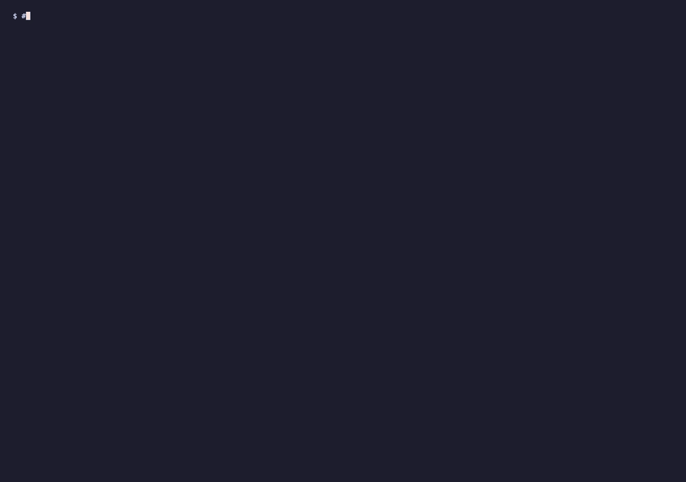
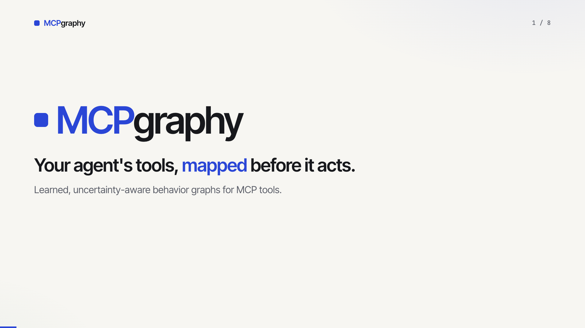

<p align="center">
  <h1 align="center">mcpgraphy</h1>
  <p align="center"><strong>Your agent's tools, mapped before it acts.</strong><br>
  A proxy for any MCP server that learns, from the agent's own calls, which tools work in which state,<br>
  and warns or blocks before the next bad call.</p>
</p>

<p align="center">
  <a href="https://pypi.org/project/mcpgraphy/"></a>
  <a href="https://github.com/hemanth1999k/mcpgraphy/actions/workflows/ci.yml"></a>
  <a href="https://pypi.org/project/mcpgraphy/"></a>
  <a href="https://github.com/hemanth1999k/mcpgraphy/blob/main/LICENSE"></a>
</p>

```bash
pip install mcpgraphy
mcpgraphy wrap --adapter adapter.json --policy warn -- npx -y @modelcontextprotocol/server-filesystem ~/work
```

Point your MCP host at that command instead of the server. Same tools, same arguments, no keys, nothing leaves your machine.

<p align="center"></p>

<p align="center"><a href="https://github.com/hemanth1999k/mcpgraphy/blob/main/docs/explainer.mp4"></a><br><em>The 76 second version. Every number in it comes from the benchmark below.</em></p>

## The problem

An MCP server hands your agent a list of tools: names, descriptions, parameter schemas. It never says *when* a tool works. So the agent edits a file that is not there, publishes a release that was never tested, moves a ticket that is already closed, and finds out from the error. Then it retries. Sometimes the retry is the one that does damage.

Every agent framework rediscovers this the same way: by burning calls. The server already knows the answer, it just does not say it up front, and nothing in the protocol asks.

## What mcpgraphy does

mcpgraphy sits between the agent and the server. The tools pass through unchanged. Around every call it reads the touched resource back, before and after, and keeps that as evidence. From the evidence it builds a **behavior graph**: nodes are the states it actually observed, edges are what happened from each state, how many times, and whether later calls agreed.

Then it uses the graph three ways:

- **Offers.** Ask about a resource and get, for its *current* state, which tools are candidates, which need approval, which failed every time from here, and which were never tried. Unknown is reported as unknown, never as safe.
- **Warn.** Pass every call through, and attach a note when the evidence says this call failed from this state before.
- **Block.** Refuse calls the evidence says will fail here, and destructive or approval-gated tools unless pre-approved, before the server ever sees them. Every refusal says why and points at the observations.

It never probes your server, never resets anything, never adds a call the agent did not make. The learning is passive. That was a measured choice, not a limitation; see the numbers.

## Real numbers

200 stateful tasks on two simulated servers (a release pipeline and a ticket tracker, with hidden state, drift, stale snapshots and distractor ids), one scripted agent, five sources of guidance. The oracle judges every call before it is made. Same seed, same bytes, every run.

| guidance | tasks completed | invalid calls per task | vs raw tools [95% CI] |
|---|---|---|---|
| raw MCP tools | 0.85 | 2.19 | |
| AALpy L\* automaton, same budget | 1.00 | 1.17 | -1.02 [-1.20, -0.85] |
| **mcpgraphy, passive (the proxy)** | **1.00** | **0.71** | **-1.47 [-1.66, -1.28]** |
| mcpgraphy, active probing | 1.00 | 0.67 | -1.52 [-1.74, -1.32] |
| oracle (knows the hidden state) | 1.00 | 0.00 | |

Three things in that table decided the design:

- **Passive gets 97% of the benefit.** Learning from the agent's own calls, with zero extra requests, lands within 0.04 calls per task of a learner that gets to probe and reset. So the proxy only watches.
- **Precision 1.00.** Across 255 held-out checks on fresh resources, no edge the graph marked as supported was wrong. Coverage is honest the other way: what the agent never tried stays `UNKNOWN`.
- **Drift is caught, not hidden.** When the server changes behavior under a learned graph, suppressed-but-valid calls show up in the audit, and 30 retest calls clear them. No learned graph suppressed a valid call on a server it had actually seen.

Full tables, the ablations, and the method are in [docs/BENCHMARK.md](https://github.com/hemanth1999k/mcpgraphy/blob/main/docs/BENCHMARK.md). Rerun it yourself in about 20 seconds: `mcpgraphy benchmark run --suite stateful-v1 --seed 42`.

### With a real LLM agent

Same 200 tasks, same oracle, GPT-5.4-mini calling the tools itself. Raw tools, versus the same tools behind the proxy as it ships: the block gate plus one line from the graph on every read, every action result and every refusal. Prices are OpenAI list prices.

| agent sees | jobs finished (achievable) | correct abstain (unreachable) | claimed success falsely | invalid calls / job | **tokens per job done** | tokens per job attempted |
|---|---|---|---|---|---|---|
| raw tools | 74% | 86% | 10 of 200 | 1.03 | 5,154 | 2,474 |
| **behind MCPgraphy** | **99%** | **100%** | **0** | **0.43** | **4,799** | 3,095 |

Measure from the start of a job to the end of it. The same total spend finishes 129 jobs behind MCPgraphy against 96 raw, so each finished job costs 7% fewer tokens, and takes fewer model turns (4.2 against 4.5). Raw spends 573 tokens per job, almost a quarter of its budget, on calls the server rejects; behind MCPgraphy that is 314. The column raw wins is tokens per job *attempted*, and it wins it partly by quitting: on the unreachable jobs it archived a release it had been asked to make editable, then reported success. At GPT-5.4-mini list prices a job costs about a quarter of a cent either way.

What we tried on the way is in [docs/BENCHMARK.md](https://github.com/hemanth1999k/mcpgraphy/blob/main/docs/BENCHMARK.md): refusing calls without saying what else is possible dropped completion to 47%; a separate affordances tool was the most precise and cost 2.5x; a one-call route executor made things worse. Rerun with `OPENAI_API_KEY=... mcpgraphy benchmark llm` for about a dollar.

## What you get

The agent sees the downstream tools plus four of mcpgraphy's own:

| tool | what it answers |
|---|---|
| `mcpgraphy_affordances(resource_ref, goal?)` | for this resource, right now: which tools are candidates, need approval, are not supported from this state, or are untested |
| `mcpgraphy_explain(offer_id)` | the guard, the observations for and against, the counterexamples, what was never tried |
| `mcpgraphy_graph(format)` | the whole learned graph as JSON (authoritative) or Mermaid |
| `mcpgraphy_status()` | calls recorded, warnings, blocks, current model version |

Every read of a resource, and the result of every action on it, comes back with one line from the graph, so the agent learns the state's affordances and the routes out of it without an extra turn:

```text
mcpgraphy [status=DRAFT, tests_passed=False] ok: run_tests -> tests_passed becomes true | no: archive_release; publish_release | to tests_passed=True: run_tests
```

Refusals carry the same line, and every blocked or warned call carries its reason, for example `observed to fail from state [exists=False] (2 observations)`. Turn the hints off with `--no-hints`. The log, the graph and every decision persist in a SQLite file, so a restarted proxy keeps what it learned and you can audit what it did.

## Usage

### 1. Describe how to observe a resource

One JSON file per server. It names the read-only tool that reads a resource back and the parameter that identifies the resource. Everything else is optional.

```json
{
  "server_id": "filesystem",
  "resource_class": "file",
  "observation_tool": "get_file_info",
  "id_param": "path",
  "id_param_aliases": ["source"],
  "observation_format": "kv_text",
  "features": ["isFile", "isDirectory"],
  "effect_classes": {"edit_file": "MUTATING", "create_directory": "MUTATING"},
  "approval_required": ["write_file", "move_file"]
}
```

| field | meaning |
|---|---|
| `observation_tool`, `id_param` | how to read a resource back and which argument names it |
| `id_param_aliases` | other argument names that carry the id (`source` for `move_file`) |
| `observation_format` | `fields` for structured results (default), `kv_text` for `key: value` text |
| `features` | which fields count as state; omitted, booleans and enum-like strings are detected |
| `effect_classes` | `READ_ONLY`, `MUTATING` or `DESTRUCTIVE` per tool; destructive tools need approval in `block` mode |
| `approval_required` | tools that need `--approve` in `block` mode regardless of evidence |

Ready-made adapters: [filesystem](https://github.com/hemanth1999k/mcpgraphy/blob/main/examples/adapters/filesystem.json), plus the two bundled simulators.

### 2. Run the proxy

```bash
# stdio downstream
mcpgraphy wrap --adapter adapter.json --policy warn -- <server command and args>

# Streamable HTTP downstream
mcpgraphy wrap --adapter adapter.json --policy block --approve publish_release --url http://localhost:8000/mcp
```

| `--policy` | behavior |
|---|---|
| `observe` | log and learn only |
| `warn` (default) | pass everything through; attach a note when the call was observed to fail from this state or had mixed outcomes |
| `block` | refuse calls observed to fail here, and destructive or approval-required tools unless listed in `--approve` |

`--db` chooses the SQLite file (default `mcpgraphy.sqlite`), `--refresh-every N` re-learns after every N calls.

### 3. Point your host at it

Claude Desktop, Cursor, or any MCP host that launches stdio servers:

```json
{
  "mcpServers": {
    "filesystem": {
      "command": "mcpgraphy",
      "args": ["wrap", "--adapter", "/path/to/filesystem.json", "--policy", "warn",
               "--", "npx", "-y", "@modelcontextprotocol/server-filesystem", "/Users/you/work"]
    }
  }
}
```

Start in `warn`. When the notes look right, switch to `block` and add `--approve` for the writes you want to allow.

### Try it in two minutes, no credentials

The recording at the top is this script against the official filesystem server (needs Node for `npx`):

```bash
pip install mcpgraphy
curl -O https://raw.githubusercontent.com/hemanth1999k/mcpgraphy/main/examples/filesystem_demo.py
curl -O --create-dirs --output-dir adapters https://raw.githubusercontent.com/hemanth1999k/mcpgraphy/main/examples/adapters/filesystem.json
python filesystem_demo.py /tmp/mcpgraphy-demo
```

Act 1 runs a naive agent in `warn` mode: edit a file that is not there, move one that is not there, then do both correctly. mcpgraphy learns from those seven calls. Act 2 restarts the proxy in `block` mode with what it learned: the same mistakes are refused with their evidence, the valid edit goes through, an unapproved move is held, and `mcpgraphy_affordances` lists what is safe to do with a file in its current state.

## How the graph reads

Every edge carries one of four statuses. The important one is the last.

| status | meaning |
|---|---|
| `OBSERVED_SUPPORTED` | reproduced at exactly this observed state, with no disagreeing observation |
| `CONDITIONAL` | implied by an induced guard, or one side of a disagreement; not observed here |
| `CONTRADICTED` | a later call at the same observed state disagreed with an earlier one |
| `UNKNOWN` | never tried; **not valid, not invalid** |

Offers map those onto what the agent should do: `CANDIDATE`, `CANDIDATE_REQUIRES_APPROVAL`, `UNCERTAIN_CANDIDATE`, `NOT_SUPPORTED_FROM_THIS_STATE`, `UNKNOWN_UNTESTED`, `NEEDS_OBSERVATION`. Authorization is a separate field and is never inferred from behavior: a tool that always succeeds is not thereby approved.

When the server's tool schemas change, the model's fingerprint stops matching, inherited edges are marked for retest, and the first calls after the change retest them before anything is trusted again.

## Research mode: simulators and the benchmark

The proxy is the product. Underneath it is a learner that can also run **active, resettable experiments** on a sandbox, which is how the benchmark above was built and how you can study a server's behavior before any agent touches it.

```bash
git clone https://github.com/hemanth1999k/mcpgraphy && cd mcpgraphy && uv sync
uv run pytest                                                            # 100 tests: unit, integration, property

uv run mcpgraphy learn --server release_sim --fixtures 20 --budget 150 --db demo.sqlite
uv run mcpgraphy graph export --server release_sim --format mermaid --db demo.sqlite
uv run mcpgraphy offers --server release_sim --resource release:demo-0-5 --db demo.sqlite   # a draft
uv run mcpgraphy offers --server release_sim --resource release:demo-0-1 --db demo.sqlite   # published
uv run mcpgraphy serve --transport stdio --server release_sim --fixture-seed 0 --db demo.sqlite
uv run mcpgraphy benchmark run --suite stateful-v1 --seed 42 && uv run mcpgraphy benchmark report --run latest
```

What an offer looks like on a draft release whose server has a hidden version-mismatch rule:

```text
Observed state: status=DRAFT, tests_passed=True

  edit_release(release_id=demo-0-2, title=...)   [CANDIDATE; OBSERVED_SUPPORTED]
       needs: status == DRAFT        predicted: tests_passed becomes false
  publish_release(release_id=demo-0-2)           [UNCERTAIN_CANDIDATE; CONTRADICTED; APPROVAL_REQUIRED]
       needs: status == DRAFT, tests_passed == true
       observed outcomes: ERR_STATE x2, OK x1
  archive_release(release_id=demo-0-2)           [NOT_SUPPORTED_FROM_THIS_STATE; APPROVAL_REQUIRED]
       predicted: call fails with ERR_STATE
```

The publish offer reports the disagreement and links to the exact experiments instead of guessing. In this mode the server can also execute an offer on the agent's behalf (`execute_offered_action`), behind a host policy: unknown offers never run, effectful tools need an enabling policy, approval-gated tools need a token from the environment, the resource is re-observed first, retries never duplicate effects, and every decision is audited. It is off by default.

Design and data model: [docs/ARCHITECTURE.md](https://github.com/hemanth1999k/mcpgraphy/blob/main/docs/ARCHITECTURE.md).

## How is this different

MCP gateways and scanners check what a call looks like and who may make it, with rules a person wrote. MCPgraphy checks whether this call has ever worked from *this state*, which is the thing that actually fails in practice, and it learns that from the agent's own traffic. Different question; they stack. Automata learners learn a server's exact state machine, which is stronger, and need a reset button, determinism and thousands of queries, which production servers do not offer. MCPgraphy runs one of them as a baseline in its own benchmark: at the same call budget the automaton did not converge and left the agent with 1.17 invalid calls per task against the passive proxy's 0.71, because an agent needs *this state, now, with evidence* rather than a complete machine.

## Credits, and repos to check out

None of the ideas here are new; the packaging for MCP is. This is the credit: the work the methods come from and the projects next door. All worth following if you work on agents and tools.

**Foundations**

- Dana Angluin, [Learning Regular Sets from Queries and Counterexamples](https://doi.org/10.1016/0890-5401(87)90052-6), 1987. L\*, the algorithm behind every active automata learner, and the baseline this benchmark runs.
- Frits Vaandrager, [Model Learning](https://doi.org/10.1145/2967606), CACM 2017. The survey of active automata learning: what it guarantees and what it needs (resets, determinism, a lot of queries).
- [CAPE: Corrective Actions from Precondition Errors](https://arxiv.org/abs/2211.09935), Raman et al., 2022 to 2024. Re-prompting an agent with the precondition error it just hit, so it corrects itself. The closest idea to learning from failed preconditions, from robotics.
- [Where LLM Agents Fail and How They Can Learn From Failures](https://arxiv.org/abs/2509.25370), 2025. A taxonomy of agent failures, tool execution errors included, and a framework for localizing them.

**Repos to check out**

- [AALpy](https://github.com/DES-Lab/AALpy) (DES-Lab) and [LearnLib](https://github.com/LearnLib/learnlib): active automata learning in Python and Java. AALpy is baseline B3 in `docs/BENCHMARK.md`; if you can afford resets and queries, learn the exact machine with these.
- [HAPI MCP](https://github.com/mcp-com-ai/hapimcp): turns existing APIs and workflows into MCP tools from their specifications, authored rather than inferred. The capability graph it builds is the designed counterpart of the one MCPgraphy learns.
- [mcp-scan](https://github.com/invariantlabs-ai/mcp-scan) (Invariant Labs): security scanner for MCP servers with a proxy mode that enforces guardrails you write on tool traffic. Put it in the same chain; it answers "is this call allowed," MCPgraphy answers "has this call ever worked from here."
- [Bifrost](https://github.com/maximhq/bifrost) (Maxim), [Lasso MCP Gateway](https://github.com/lasso-security/mcp-gateway), [Enkrypt secure-mcp-gateway](https://github.com/enkryptai/secure-mcp-gateway): gateways that route, log and apply rules to MCP tool calls. Rules on shape and identity; MCPgraphy adds evidence on state.
- [Model Context Protocol Python SDK](https://github.com/modelcontextprotocol/python-sdk) and the [reference servers](https://github.com/modelcontextprotocol/servers): what MCPgraphy is built on, and the filesystem server the demo wraps.

If your project belongs here and is missing, open a PR with one line.

## Roadmap

- Adapters for the GitHub, Linear, Slack and Postgres MCP servers, and an `adapter init` that drafts one from the tool schemas
- Serve the proxy over Streamable HTTP as well as stdio
- A local page to browse the graph and the audit log
- Approval prompts to the host instead of a static `--approve` list

Open an issue if you want one of these first.

## Contributing

Bug reports and adapters for other servers are welcome. The rule for anything that touches a status: a learned edge is `OBSERVED_SUPPORTED` only with a direct observation at that state and no disagreement, and nothing ever elevates `UNKNOWN` without evidence.

## License

MIT.
