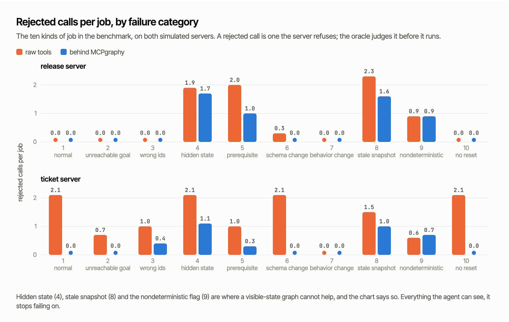
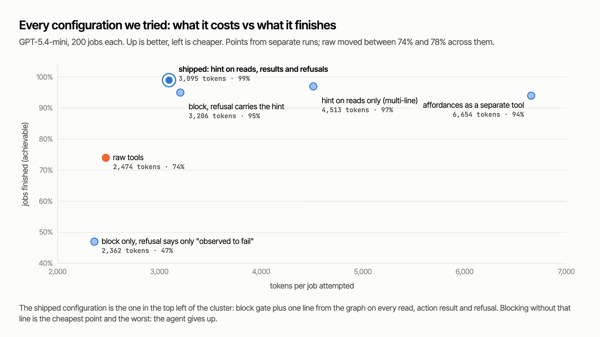

# The benchmark

`mcpgraphy benchmark run --suite stateful-v1 --seed 42` reproduces every number in this file in about 20 seconds. Same seed, same bytes.

## Setup

**Two simulated servers**, each with visible state the agent can read back and hidden state it cannot, and each with a `v2` that drifts from `v1`:

- `release_sim`: releases move DRAFT, PUBLISHED, ARCHIVED through `edit`, `run_tests`, `publish`, `archive`. Hidden: a lock flag and a "tests ran on this version" flag, so a draft that looks publishable sometimes is not.
- `ticket_sim`: tickets move OPEN, IN_PROGRESS, DONE, CLOSED through `assign`, `move`, `close`, with users scoped to projects. Hidden: a write-denied flag.

**Ten scenario categories**, ten seeds each, on both servers: 200 scenarios.

| # | category | what makes it hard |
|---|---|---|
| 1 | normal | a reachable goal, several valid routes |
| 2 | invalid guard | the goal is unreachable from this state; the right answer is to stop |
| 3 | wrong ids | stale, other-tenant and look-alike ids as distractors |
| 4 | hidden state | a lock or permission flag the agent cannot see |
| 5 | alternate sequence | the obvious call fails until a prerequisite is redone |
| 6 | schema change | the server is `v2`, the model was learned on `v1` |
| 7 | behavior change | `v2` allows what `v1` refused |
| 8 | stale snapshot | the resource changes between read and act |
| 9 | nondeterministic | a seed-dependent hidden flag |
| 10 | no reset | the sandbox refuses resets; the learner must abstain |

**One scripted agent, five sources of guidance.** The agent observes, checks the goal, ranks actions by a fixed hand-written prior that is identical for every baseline, lets the guidance source label each action supported / uncertain / unknown / not supported, skips what is labelled not supported, and tries the first remaining action. An oracle that knows the hidden state judges every call *before* it is made, so "invalid call" is ground truth, not a guess. Six steps maximum per task.

| guidance | what it knows |
|---|---|
| B0 raw tools | the tool list only; everything is unknown, nothing is suppressed |
| B2 oracle | the hidden state; the upper bound |
| B3 AALpy L\* | a Mealy machine learned by active automata learning under the same probe budget as B5 |
| B4 passive traces | a graph built only from logged B0 traffic on other seeds, zero extra calls; this is what the proxy does |
| B5 learned offers | a graph from the active explorer: 20 fixtures, 150-probe budget, resets allowed |

Learner seeds and benchmark seeds never overlap, so every model is evaluated on resources it has not seen.

## Results, seed 42

| guidance | completion (achievable tasks) | invalid calls / task | vs B0 [95% CI, paired bootstrap] | false suppression |
|---|---|---|---|---|
| B0 raw tools | 0.85 | 2.19 | | 0.00 |
| B2 oracle | 1.00 | 0.00 | -2.19 [-2.43, -1.96] | 0.00 |
| B3 AALpy L\* (did not converge at budget 150; trace fallback) | 1.00 | 1.17 | -1.02 [-1.20, -0.85] | 0.08 |
| B4 passive traces (0 probes) | 1.00 | 0.71 | -1.47 [-1.66, -1.28] | 0.08 |
| B5 learned offers (110 probes) | 1.00 | 0.67 | -1.52 [-1.74, -1.32] | 0.08 |
| B5 without replication probes | 1.00 | 0.56 | -1.62 [-1.82, -1.43] | 0.09 |
| B5 without argument classes | 1.00 | 0.56 | -1.62 [-1.82, -1.43] | 0.09 |
| B5 without induced guards | 1.00 | 0.67 | -1.52 [-1.74, -1.32] | 0.08 |
| B5 with UNKNOWN treated as valid | 1.00 | 0.77 | -1.42 [-1.60, -1.25] | 0.08 |
| B5 retested after drift (categories 6 and 7 only, n = 40) | 1.00 | 0.00 | -0.50 [-0.68, -0.35] | 0.00 |

*False suppression* is the share of tasks in which guidance suppressed an action the oracle says was valid. It is reported separately from completion because a tool that is safe by never letting the agent do anything would score perfectly on invalid calls.

Model level: the learned graph's edges marked supported were re-checked on five held-out fixtures per server, 255 checks in all, and none was wrong (precision 1.00). B5 covers every visible-state by core-action pair (36/36 and 64/64); B4 covers 16/36 and 27/64, because the agent's own traffic never visits some pairs. Given an unlimited budget, L\* needs about 870 probes and 247 resets to converge on `release_sim`.

## How to read it

- **Any state-conditioned evidence removes most invalid calls.** Every guided source reaches the oracle's completion rate on achievable tasks, and the confidence intervals exclude zero.
- **Passive gets 97% of the benefit of active.** Logging the agent's own traffic, with no extra request, lands within 0.04 calls per task of the active learner. This is why the proxy only watches. Active probing buys coverage of pairs the agent never tried, which matters for offers, not for this agent's call count.
- **The replication and argument-class mechanisms do not lower invalid calls here, they raise them slightly.** They turn some edges into `CONTRADICTED` or `UNCERTAIN`, and the scripted agent treats uncertain like supported, so it tries them anyway while the budget spent on replication covered fewer pairs. Their value is in the offer: a linked counterexample and an honest label, which a human or a more careful agent can act on. This agent cannot.
- **Saying unknown is worth something.** Forcing `UNKNOWN` to count as valid costs 0.10 invalid calls per task with no completion gain.
- **Drift is caught, not hidden.** All false suppression comes from a `v1` graph used on a `v2` server. Thirty retest probes clear it. No graph suppressed a valid call on a server it had actually observed.
- **Hidden state is where everyone but the oracle fails.** In categories 4, 8 and 9 the learned graph still makes about 2.5 invalid calls per task on `release_sim`. The offers say uncertain, which is correct and not enough.

## With a real LLM agent

`OPENAI_API_KEY=... mcpgraphy benchmark llm --model gpt-5.4-mini` runs the same 200 scenarios with a real model calling the tools. The default arms:

| arm | what the agent sees |
|---|---|
| `raw` | the server's tools |
| `route` | the same tools behind the proxy as it ships: block-mode gate on the passive-trace graph (every tool pre-approved, so the gate acts on evidence only), and one line from the graph on every read, every action result and every refusal: the state, what is ok from it and what each action changes, what is not supported, and the shortest observed route to each reachable state |

The oracle judges every mutating call before it executes, so "invalid call" is ground truth. The model ends a task with `GOAL_REACHED` or `GOAL_UNREACHABLE`; a `GOAL_REACHED` that the read-back contradicts is a false success. Every model turn is tagged by what it produced (an action, a rejected call, a refused call, a read, the final answer), so tokens can be attributed. Tokens and dollars come from the API's usage field at list prices. The model samples, so numbers move a little between runs; repeated runs of the same configuration agreed within two points on every column.

### Results, GPT-5.4-mini, 2026-11-01, 200 scenarios

| arm | completed (achievable) | correct abstain (unreachable) | false success | invalid calls / task | blocked / task | valid calls blocked | model turns / task | tokens / task | tokens / completed task | cost / task |
|---|---|---|---|---|---|---|---|---|---|---|
| raw | 0.74 | 0.86 | 10 | 1.03 | 0 | 0 | 4.46 | 2,474 | 5,154 | $0.0022 |
| route (default) | 0.99 | 1.00 | 0 | 0.43 | 0.15 | 0 | 4.22 | 3,095 | 4,799 | $0.0026 |

Paired, route minus raw (95% bootstrap CI, n = 200): invalid calls -0.60 [-0.71, -0.48]; tokens +621 [+482, +771].

Tokens per task by what the model turn produced:

| arm | productive action | rejected call | refused call | read | final answer |
|---|---|---|---|---|---|
| raw | 563 | 573 | 0 | 713 | 625 |
| route | 1,147 | 314 | 104 | 658 | 872 |

How to read it:

- **A quarter of raw's budget is waste.** 573 of 2,474 tokens go to turns that end in a call the server rejects. The graph removes most of that; what remains is the hidden-state categories, where nothing short of the oracle knows.
- **The proxy spends more on doing the task, not on failing it.** Productive action turns cost twice as much behind the proxy because the agent completes 129 tasks instead of 96, and each turn carries a longer context: about 180 more prompt tokens per request, mostly the accumulated graph lines.
- **Measured start of job to end of job, the proxy is cheaper.** 4,799 tokens per finished job against 5,154, in 4.2 model turns against 4.5. Per job *attempted* it costs 25% more; that column counts an abandoned job as a cheap one. The number that matters for a bill is the first.
- **Nothing valid was blocked, and nothing false was claimed.** Zero suppressed valid calls, zero false successes, against ten false successes for raw, one of them after archiving a release the agent had been asked to make editable.

### By failure category

On everything the agent can observe (normal, unreachable goal, wrong ids, prerequisite, schema change, behavior change, no reset) the proxy takes rejected calls to zero or near it. Hidden state (4), stale snapshots (8) and the seed-dependent flag (9) are where a graph of visible state cannot know the answer, and the chart shows the proxy failing there at close to raw's rate: it says uncertain, which is correct and not enough.

### Configurations tried on the way

Earlier runs of the same scenarios, same model. Each changed the design.

| configuration | completed | false success | invalid / task | tokens / task | lesson |
|---|---|---|---|---|---|
| block only, refusal says only "observed to fail" | 0.47 | 8 | 0.38 | 2,362 | cheaper than raw, but the agent gives up; a refusal must carry the alternatives |
| block, refusal carries the hint | 0.95 | 7 | 0.51 | 3,206 | most of the benefit, lowest overhead |
| multi-line hint on reads only | 0.97 | 1 | 0.51 | 4,513 | reads cost a turn each; the hint belongs on action results too |
| `mcpgraphy_affordances` as a separate tool | 0.94 | 6 | 0.36 | 6,654 | most precise, 2.5x tokens: a question is a whole extra turn |
| `mcpgraphy_reach`: execute the route in one call (50-task sample) | 0.55 | 4 | 0.42 | 3,671 | worse: the passive graph often has no complete route, the agent asks, gets none, and stops |

Caveats specific to these runs: one model, one prompt, no retries on the model's side; the graph is frozen for the run, where the real proxy keeps learning from the calls it sees; cost is list price for GPT-5.4-mini; tasks are at most six steps long, so raw's retry waste is bounded, and the proxy's per-turn overhead is not amortized over a long job.

## Caveats

- The agent is a deterministic script, not an LLM. No tokens, prompts or context cost were measured.
- The servers are simulators built for this benchmark; the only real server wrapped so far is the official filesystem server, in the README demo.
- Feature extractors (what counts as state) are declared in the adapter or detected from booleans and enum-like strings, not learned.
- The agent's policy was adjusted three times during development, each time to remove an artifact that affected every baseline equally, never to favor one: label rank no longer overrides goal order, a success unblocks earlier failures, and the same action is tried at most twice per observed state.

## Outputs

`experiments/runs/<run_id>/` holds `results.jsonl` (one row per scenario and guidance source), `models/*.json`, `summary.json`, `summary.csv` and `report.md`. `mcpgraphy benchmark report --run latest` prints the tables above.
